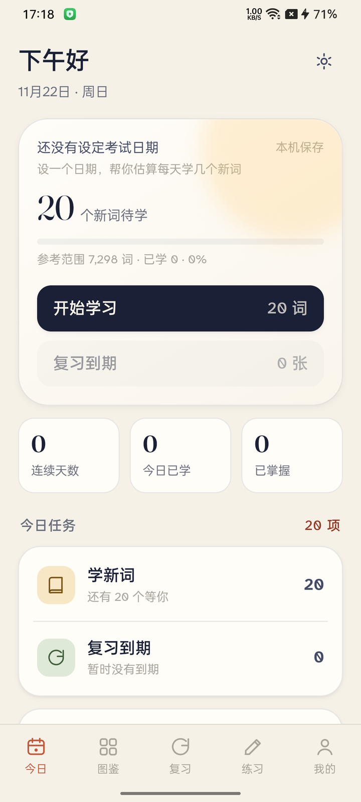
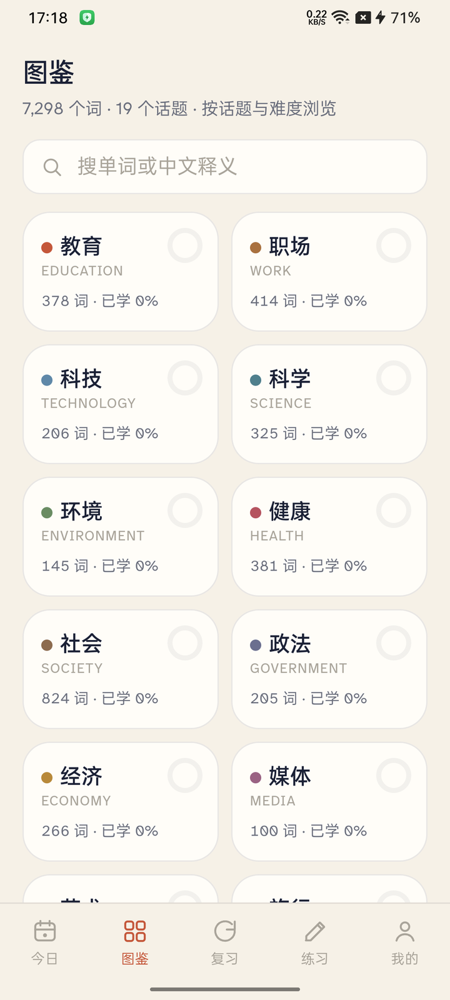
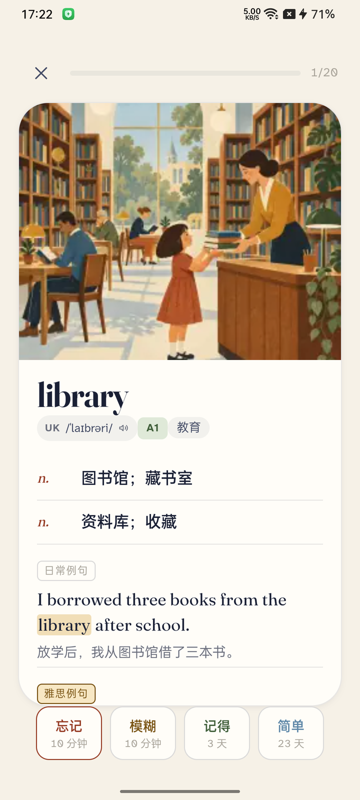
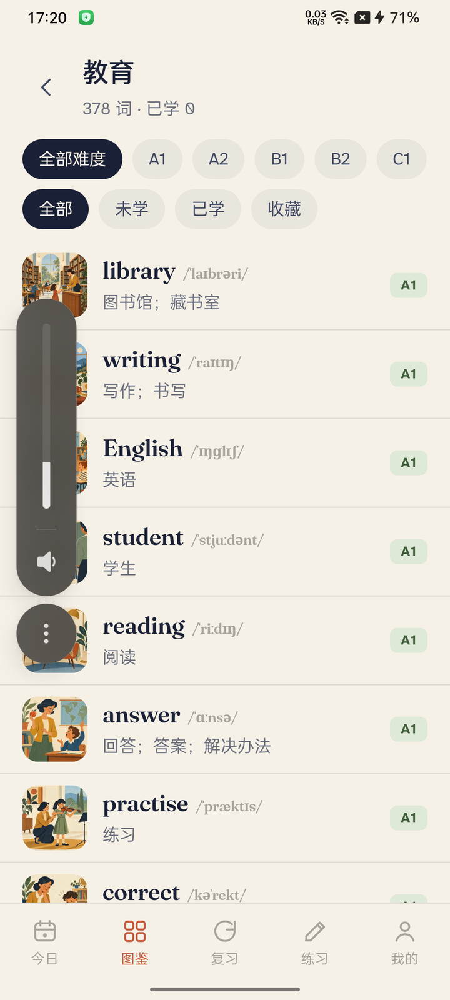
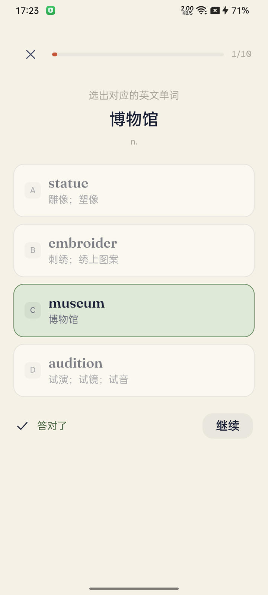
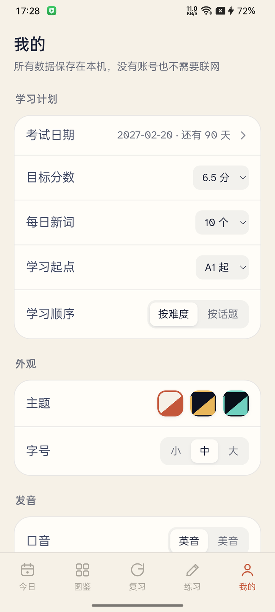
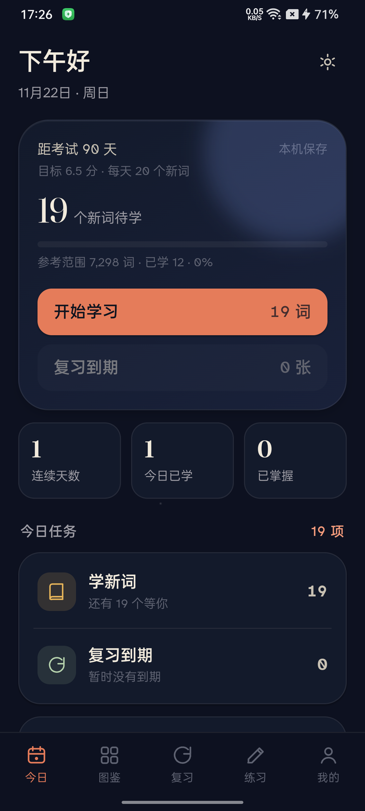

# 拾词 · 雅思词汇图鉴（Android）

[](LICENSE)
[](CONTENT_LICENSE.md)
[](#安装)
[](https://github.com/JopeyZhang/Shici/releases/latest)

把 **Word Atlas（词光）** 的开放雅思词库做成一个**完全离线**的安卓背词 App：
一词一画、双语例句、FSRS 间隔复习、五类练习。**没有账号、没有登录、不联网、不申请任何权限。**

> [!IMPORTANT]
> 本项目是**第三方客户端**，基于 [designfuchen/word-atlas](https://github.com/designfuchen/word-atlas)
> 的词库与插画制作，**不是上游官方项目，与上游维护者无隶属关系、未获其背书**。
> 词库与插画以 **CC BY 4.0** 授权，署名 **Word Atlas contributors**；
> 界面设计参考其公开站点，代码为本项目独立实现。详见 [来源与署名](#数据来源与署名)。






## 功能

| 页面 | 内容 |
|---|---|
| 今日 | 考试日期倒计时、每日新词量、范围内已学进度、连续天数；一键学习 / 复习 |
| 图鉴 | 19 个话题（词数 + 已学比例）、CEFR / 未学 / 已学 / 收藏筛选、中英文搜索、7,298 词分页列表 |
| 词详情 | 256px 插画、UK/US 音标与系统 TTS 发音、全部释义、日常 + 雅思例句（关键词高亮）、搭配、词族、同反义词跳转、考点提示、收藏、左右滑动切词 |
| 复习 | FSRS-4.5 到期队列，先回想再揭晓，四档评分实时显示下次间隔 |
| 练习 | 看中文选英文 / 看英文选中文 / 听音选词 / 看图选词 / 拼写；一组 10 题，答错不自动跳题，同一词最多重排一次 |
| 我的 | 备考日期、目标分、每日新词、学习起点、学习顺序；纸感 / 星光 / 极光主题；字号；英/美音；系统语音状态；进度导出/导入；清空进度 |

- **7,298** 个词条、**19** 个话题、**6** 级 CEFR（A1 785 / A2 1,039 / B1 1,465 / B2 2,127 / C1 1,608 / C2 274）。
- 每个词条 14 个字段：拼写、英美音标、多义项中英释义、2 条例句、搭配、词族、同反义词、考点提示、CEFR、话题。
- 界面为原生 WebView 壳 + 零依赖前端，**不引入任何 JS 框架 / npm 运行时依赖**。

| | |
|---|---|
|  |  |
|  |  |

## 安装

**方式一：下载 Release（推荐）**

到 [Releases](https://github.com/JopeyZhang/Shici/releases/latest) 下载 `shici-1.0.0.apk`（约 74MB），
传到手机点开安装；首次需允许「安装未知应用」。

**方式二：adb**

```powershell
adb install -r shici-1.0.0.apk
```

- 最低 Android 6.0（minSdk 23），目标 Android 14（targetSdk 34），竖屏。
- **不申请任何权限**（连 `INTERNET` 都没有），安装包内无 native 库，任意 CPU 架构可装。
- 官方 Release 使用私有签名密钥；自行构建的 APK 签名不同，安装前需先卸载官方版。

## 数据来源与署名

- 词库：[`data/word-atlas.json`](data/word-atlas.json)，7,298 词，与上游 `data/word-atlas.json`
  **逐字节一致**（blob `2b3ee14…`，SHA-256 `e4e34108…`）。
- 插画：`web/assets/words/*.webp`，7,298 张 256px 缩略图，取自上游公开发布的 `atlas/thumb/`。
- 来源项目：[designfuchen/word-atlas](https://github.com/designfuchen/word-atlas)（词光 Word Atlas）。
- 内容授权：**CC BY 4.0** — **Word Atlas contributors**
  （[许可证](https://creativecommons.org/licenses/by/4.0/)，全文见 [`licenses/CC-BY-4.0.txt`](licenses/CC-BY-4.0.txt)）。
- 修改说明：词库原样使用；插画未做二次编辑；**未包含**上游音频与品牌素材。
- 字体：Fraunces / Source Serif 4 / Atkinson Hyperlegible Next，SIL OFL 1.1，
  见 [`THIRD_PARTY_NOTICES.md`](THIRD_PARTY_NOTICES.md)。

完整声明（含免责、商标、再分发要求）见 [`CONTENT_LICENSE.md`](CONTENT_LICENSE.md)。

> [!NOTE]
> - 本项目**不是**官方雅思词表，与 British Council、IDP、Cambridge 无任何关联。
> - 词条、例句、译文与插画由上游使用 AI 模型生成，**未经逐条人工审校**，按现状提供，不保证准确性。
> - “Word Atlas”“词光”“IELTS”“雅思”等名称仅作来源说明或描述性使用，相关权利归各自权利人。

## 隐私

- 无账号、无登录、无密码、无云同步、无统计 SDK。
- APK 不申请网络权限，不会发起任何网络请求；飞行模式可完整使用。
- 学习进度仅保存在本机 `SharedPreferences`（键 `progress.v1`），卸载即删除。
- 导出/导入通过 Android 系统文件选择器，文件位置由你决定。

## 构建

需要 **JDK 17** + **Android SDK build-tools 34 / platform 34**（不依赖 Gradle）：

```powershell
# 1. 生成运行时词库（web/js/data.js 为生成物，未提交）
node tools/prepare_data.mjs

# 2. 设置签名密码（仓库不包含 keystore；首次构建会自动生成新 keystore）
$env:SHICI_KS_PASS = "your-keystore-password"

# 3. 构建
powershell -NoProfile -ExecutionPolicy Bypass -File .\build.ps1
# 产物：out\拾词-1.0.apk
```

脚本按以下顺序查找 SDK / JDK：

- SDK：`$env:ANDROID_SDK_ROOT` → `../jetwar-android/tools/sdk`
- JDK：`$env:JAVA_HOME` → PyCharm 自带 JBR

插画已随仓库提交；如需重新抓取（需要网络）：

```powershell
node tools/fetch_media.mjs --concurrency 12
node tools/fetch_fonts.mjs
```

## 项目结构

```
Shici/
├─ data/word-atlas.json      词库（CC BY 4.0，来源见 data/README.md）
├─ web/                      离线前端（可直接浏览器打开 web/index.html 预览）
│  ├─ index.html / css/app.css / js/{app,fsrs,store}.js
│  ├─ assets/words/*.webp    7,298 张 256px 插画（CC BY 4.0）
│  ├─ assets/fonts/*.woff2   拉丁字体子集（OFL 1.1）
│  └─ licenses/              随 APK 分发的许可证文本
├─ android/                  Manifest、MainActivity（WebView、TTS、SAF）
├─ tools/                    数据生成、素材抓取、图标、测试、预览脚本
├─ docs/                     架构说明与截图
├─ build.ps1                 一键构建（aapt2 → javac → d8 → zipalign → apksigner）
├─ LICENSE                   MIT（仅代码与文档）
└─ CONTENT_LICENSE.md        CC BY 4.0（词库与插画）
```

## 测试

```powershell
node tools/test_fsrs.mjs    # FSRS 调度 21 项断言
node tools/test_data.mjs    # 词库与 7,298 张插画完整性 18 项断言
```

CI 在每次 push / PR 时运行上述测试与 JS 语法检查（[`ci.yml`](.github/workflows/ci.yml)）。

桌面预览（可选，需要 Edge/Chromium）：

```powershell
powershell -NoProfile -ExecutionPolicy Bypass -File .\tools\preview.ps1
node tools/smoke.mjs
```

## 真机验证

已在 **OPPO PCLM10（Android 12，1080×2400）** 上逐项验证：

- 五页、19 话题、词表筛选与搜索、词详情、左右滑动、返回键；
- 学习评分写入本地，「今日已学 / 连续天数 / 待学」实时更新，杀进程重开保留；
- 练习答对/答错/继续/结果页，结果写回 FSRS；
- 考试日期选择器 → 今日倒计时；
- 导出 `shici-progress.json`（4.7KB）→ 修改 → 导入设置恢复；
- 纸感 / 星光主题与状态栏配色、清空进度；
- 系统 TTS（iFlytek）绑定成功并能发音；
- `dumpsys package` 确认无任何权限。

## 已知限制

- 256px 插画在词详情页会略微放大（为了把 APK 控制在 74MB；512px 版本约 200MB+）。
- 发音依赖手机系统 TTS；若未安装英文语音，可在「我的 → 发音 → 设置」安装/启用。
- 无云同步、无多设备进度合并；换机请用导出/导入。
- 主题手动切换，不跟随系统深色模式。
- 部分国产 ROM 在播放系统 TTS 时会弹出悬浮音量/音频控制条，属系统 UI。

## 许可

| 内容 | 许可 |
|---|---|
| 本项目源代码与文档 | [MIT](LICENSE) |
| 词库、插画 | [CC BY 4.0](CONTENT_LICENSE.md)，Word Atlas contributors |
| 字体 | [SIL OFL 1.1](THIRD_PARTY_NOTICES.md) |
| 上游 Word Atlas 代码 | MIT（仅作来源说明，本项目未复制其源码） |

## 致谢

- [designfuchen/word-atlas](https://github.com/designfuchen/word-atlas) — 词库、插画与界面参考
- Fraunces、Source Serif 4、Atkinson Hyperlegible Next — 字体作者
- Android SDK Build-Tools、OpenJDK、Pillow、Node.js — 构建工具

---

**English**：参见 [README.en.md](README.en.md)。
